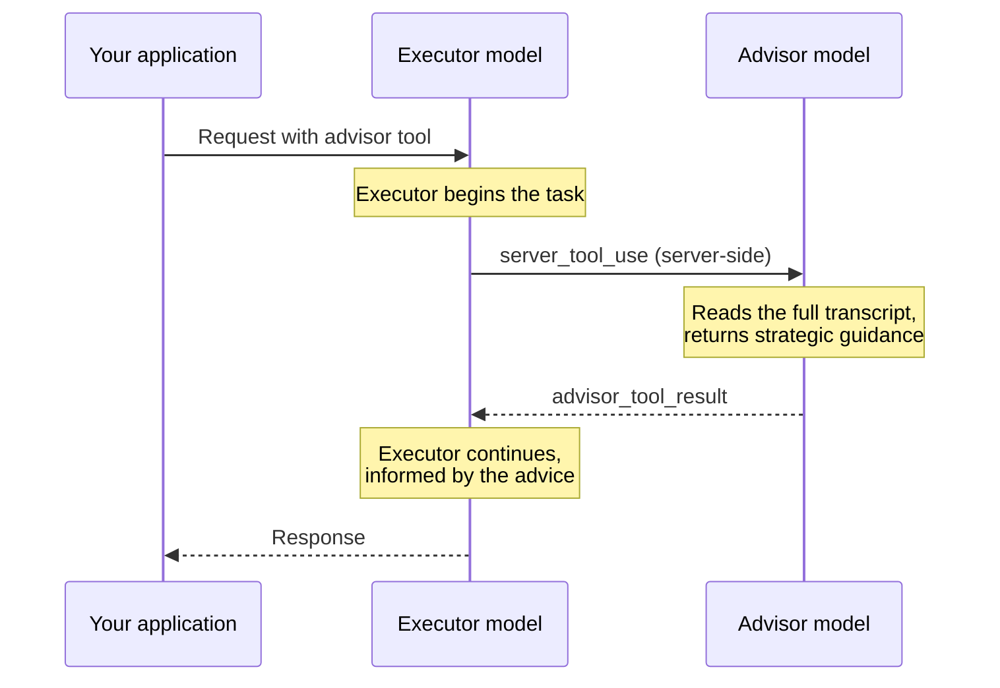

**API support**: Usage differs by product.

* **Messages API**: Add an advisor tool (type `advisor_20260301`) to the request’s `tools`.
* **Managed Agents**: Set `advisor` in the agent’s `multiagent` block; there are no `max_uses` or `max_tokens` options.

The advisor tool lets a faster, lower-cost **executor model** consult a higher-intelligence **advisor model** mid-generation for strategic guidance. The advisor reads the full conversation and produces a plan or course correction, and the executor continues with the task.

This pattern fits long-horizon agentic workloads (coding agents, computer use, multistep research pipelines) where most turns are mechanical but having an excellent plan is crucial. You get close to advisor-solo quality while the bulk of token generation occurs at executor-model rates. For measured results, including how the benefit shrinks as the executor’s own capability approaches the advisor’s, see [Optimizing for cost and intelligence](https://platform.claude.com/docs/en/about-claude/models/optimizing-for-cost-and-intelligence?sdk_languages=cli).



## When to use it

The advisor fits these configurations:

* **You currently use Sonnet on complex tasks:** Add a higher-tier advisor. Opus keeps total cost similar or lower; Claude Fable 5.2 maximizes the quality lift.
* **You currently use Haiku and want a step up in intelligence:** Add an Opus or Fable advisor. Expect higher cost than Haiku alone, but lower than switching the executor to a larger model.

Results are task-dependent. Evaluate on your own workload.

The advisor is a weaker fit for single-turn Q\&A (nothing to plan), pure pass-through model pickers where your users already choose their own cost and quality tradeoff, or workloads where every turn genuinely requires the advisor model’s full capability.

## Quick start

<Note>
  The advisor tool is in beta. Include the beta header `advisor-tool-2026-03-01` in your requests.
</Note>

<CodeGroup>
  ```bash CLI
  ant beta:messages create --beta advisor-tool-2026-03-01 <<'YAML'
  model: claude-sonnet-5
  max_tokens: 16000
  tools:
    - type: advisor_20260301
      name: advisor
      model: claude-opus-5-5
  messages:
    - role: user
      content: Build a concurrent worker pool in Go with graceful shutdown. Keep it brief.
  YAML
  ```
</CodeGroup>

The response `content` includes an `advisor_tool_result` block carrying the advisor’s guidance. With the newest Opus model as the advisor, as in this quick start, the block’s `content` field is an `advisor_redacted_result` variant (encrypted; the executor reads it server-side, but your client does not). To see the advice text directly in your response, use `claude-opus-4-8` as the advisor model instead, which returns the plaintext `advisor_result` variant. See [Result variants](https://platform.claude.com/docs/en/agents-and-tools/tool-use/advisor-tool?sdk_languages=cli#result-variants) for both shapes side by side and which advisor models return which, and [Model compatibility](https://platform.claude.com/docs/en/agents-and-tools/tool-use/advisor-tool?sdk_languages=cli#model-compatibility) for the full list of valid pairs.

## How it works

When you add the advisor tool to your `tools` array, the executor model determines when to call it, like any other tool. When the executor calls the advisor:

1. The executor emits a [`server_tool_use`](https://platform.claude.com/docs/en/agents-and-tools/tool-use/server-tools?sdk_languages=cli) block with `name: "advisor"` and an empty `input`. The executor signals timing, and the server supplies context.
2. Anthropic runs a separate inference pass on the advisor model server-side. The advisor runs under its own Anthropic-supplied system prompt and receives the executor’s full transcript as quoted context in its input. That transcript includes your system prompt, the tool definitions, the prior turns and tool results, and the text the executor has produced so far in this turn.
3. The advisor’s response returns to the executor as an `advisor_tool_result` block.
4. The executor continues generating, informed by the advice.

All of this occurs inside a single `/v1/messages` request, with no extra round trips on your side. The exception is a turn that pauses mid-call, which you resume with a follow-up request (see [Resuming a paused turn](https://platform.claude.com/docs/en/agents-and-tools/tool-use/advisor-tool?sdk_languages=cli#resuming-a-paused-turn)).

The advisor itself runs without tools and without context management. Its thinking blocks are dropped before the result returns. Only the advice text reaches the executor.

## Tool parameters

| Parameter    | Type           | Default                    | Description                                                                                                                                                                                                                                                                                                                                                                                                      |
| ------------ | -------------- | -------------------------- | ---------------------------------------------------------------------------------------------------------------------------------------------------------------------------------------------------------------------------------------------------------------------------------------------------------------------------------------------------------------------------------------------------------------- |
| `type`       | string         | *required*                 | Must be `"advisor_20260301"`.                                                                                                                                                                                                                                                                                                                                                                                    |
| `name`       | string         | *required*                 | Must be `"advisor"`.                                                                                                                                                                                                                                                                                                                                                                                             |
| `model`      | string         | *required*                 | The advisor model ID, such as claude-opus-5-5. Billed at this model’s rates for the sub-inference.                                                                                                                                                                                                                                                                                                               |
| `max_uses`   | integer        | unlimited                  | Maximum number of advisor calls allowed in a single turn. Once the executor reaches this cap, further advisor calls return an `advisor_tool_result_error` with `error_code: "max_uses_exceeded"` and the executor continues without further advice. See [Cost control](https://platform.claude.com/docs/en/agents-and-tools/tool-use/advisor-tool?sdk_languages=cli#cost-control) for conversation-level limits. |
| `max_tokens` | integer        | advisor model’s output cap | Caps the advisor’s total output (thinking plus text) per call. Minimum 1024. See [Capping advisor output](https://platform.claude.com/docs/en/agents-and-tools/tool-use/advisor-tool?sdk_languages=cli#capping-advisor-output).                                                                                                                                                                                  |
| `caching`    | object \| null | `null` (off)               | Enables [prompt caching](https://platform.claude.com/docs/en/build-with-claude/prompt-caching?sdk_languages=cli) for the advisor’s own transcript across calls within a conversation. See [Advisor prompt caching](https://platform.claude.com/docs/en/agents-and-tools/tool-use/advisor-tool?sdk_languages=cli#advisor-prompt-caching).                                                                         |

The `max_uses` cap applies to a whole turn, and a turn can span several requests. A request continues the turn when it [resumes after `pause_turn`](https://platform.claude.com/docs/en/agents-and-tools/tool-use/advisor-tool?sdk_languages=cli#resuming-a-paused-turn) or when its last message contains only `tool_result` blocks. Advisor calls from earlier requests in that turn count against the cap.

The `caching` object has the shape `{"type": "ephemeral", "ttl": "5m" | "1h"}`. Unlike `cache_control` on content blocks, this is not a breakpoint marker. It is an on/off switch. The server determines where cache boundaries go.

The advisor tool also accepts the generic properties available on any tool definition: `cache_control`, `allowed_callers`, `defer_loading`, and `strict` (covered in [Structured outputs](https://platform.claude.com/docs/en/build-with-claude/structured-outputs?sdk_languages=cli)). See [Tool definition properties](https://platform.claude.com/docs/en/agents-and-tools/tool-use/tool-reference?sdk_languages=cli#tool-definition-properties) in the Tool reference for their semantics.

## Response structure

### Successful advisor call

When the advisor is called, a `server_tool_use` block is followed by an `advisor_tool_result` block in the assistant’s content. The following example shows the plaintext `advisor_result` variant returned by a Claude Opus 4.8 advisor. The [Quick start](https://platform.claude.com/docs/en/agents-and-tools/tool-use/advisor-tool?sdk_languages=cli#quick-start) uses the newest Opus model, which returns the encrypted `advisor_redacted_result` variant instead; see [Result variants](https://platform.claude.com/docs/en/agents-and-tools/tool-use/advisor-tool?sdk_languages=cli#result-variants) for both shapes side by side.

```json
{
  "role": "assistant",
  "content": [
    {
      "type": "text",
      "text": "Let me consult the advisor on this."
    },
    {
      "type": "server_tool_use",
      "id": "srvtoolu_abc123",
      "name": "advisor",
      "input": {}
    },
    {
      "type": "advisor_tool_result",
      "tool_use_id": "srvtoolu_abc123",
      "content": {
        "type": "advisor_result",
        "text": "Use a channel-based coordination pattern. The tricky part is draining in-flight work during shutdown: close the input channel first, then wait on a WaitGroup..."
      }
    },
    {
      "type": "text",
      "text": "Here's the implementation. I'm using a channel-based coordination pattern to avoid writer starvation..."
    }
  ]
}
```

The `server_tool_use.input` is always empty. The server constructs the advisor’s view from the full transcript automatically. Nothing the executor puts in `input` reaches the advisor.

### Result variants

The `advisor_tool_result.content` field is a discriminated union. For successful calls, the variant depends on the advisor model:

| Variant                   | Fields                             | Returned when                                                       |
| ------------------------- | ---------------------------------- | ------------------------------------------------------------------- |
| `advisor_result`          | `text`, `stop_reason`              | The advisor model returns plaintext (for example, Claude Opus 4.8). |
| `advisor_redacted_result` | `encrypted_content`, `stop_reason` | The advisor model returns encrypted output.                         |

<Note>
  Claude Fable 5.2, Claude Mythos 5.2, Claude Sonnet 5.5, Claude Fable 5.1, Claude Mythos 5.1, Claude Opus 5.5, Claude Opus 5, Claude Fable 5, Claude Mythos 5, and Claude Haiku 5.5 advisors return the encrypted `advisor_redacted_result`. Every other advisor model in [Model compatibility](https://platform.claude.com/docs/en/agents-and-tools/tool-use/advisor-tool?sdk_languages=cli#model-compatibility) returns the plaintext `advisor_result`. To read the advice text in your own responses, use an advisor that returns plaintext, such as `claude-opus-4-8`, where [Model compatibility](https://platform.claude.com/docs/en/agents-and-tools/tool-use/advisor-tool?sdk_languages=cli#model-compatibility) lists one for your executor. Claude Fable 5.2, Claude Mythos 5.2, Claude Sonnet 5.5, Claude Fable 5.1, Claude Mythos 5.1, Claude Opus 5.5, Claude Opus 5, Claude Fable 5, and Claude Mythos 5 executors pair only with advisors that return the encrypted form, so on those executors the advice text isn’t readable in the response.
</Note>

Here is the same request sent twice, identical except for the advisor `model` in the tool definition, showing both variants.

With `"model": "claude-opus-4-8"`, the advice is plaintext:

```json
{
  "type": "advisor_tool_result",
  "tool_use_id": "srvtoolu_abc123",
  "content": {
    "type": "advisor_result",
    "text": "Use a channel-based coordination pattern. The tricky part is draining in-flight work during shutdown: close the input channel first, then wait on a WaitGroup..."
  }
}
```

With `"model": "claude-opus-5-5"`, the advice is encrypted:

```json
{
  "type": "advisor_tool_result",
  "tool_use_id": "srvtoolu_abc123",
  "content": {
    "type": "advisor_redacted_result",
    "encrypted_content": "EqQBCkYIBRgCIiQ5ZjE0N2M2OC0yYWIxLTRkZTktYjA3ZC1hZTUyMzkxYjhkMmU..."
  }
}
```

Both result variants carry a `stop_reason` field when you set [`max_tokens`](https://platform.claude.com/docs/en/agents-and-tools/tool-use/advisor-tool?sdk_languages=cli#capping-advisor-output) on the tool definition, and omit it when you do not. It holds the advisor sub-call’s stop reason, typically `"end_turn"`, or `"max_tokens"` when the cap is hit. The values match the top-level Messages API [`stop_reason`](https://platform.claude.com/docs/en/build-with-claude/handling-stop-reasons?sdk_languages=cli).

With `advisor_result`, the `text` field contains human-readable advice. With `advisor_redacted_result`, the `encrypted_content` field contains an opaque blob that you cannot read. In the next request, the server decrypts it and renders the plaintext into the executor’s prompt.

In both cases, round-trip the content verbatim in later requests. If you switch advisor models mid-conversation, branch on `content.type` to handle both shapes. A switch is an edit to `tools`, so read [Multi-turn conversations](https://platform.claude.com/docs/en/agents-and-tools/tool-use/advisor-tool?sdk_languages=cli#multi-turn-conversations) before you make one in a conversation that carries thinking blocks.

### Error results

If the advisor call fails, the result carries an error:

```json
{
  "type": "advisor_tool_result",
  "tool_use_id": "srvtoolu_abc123",
  "content": {
    "type": "advisor_tool_result_error",
    "error_code": "overloaded"
  }
}
```

The executor receives the error and continues without further advice. The request itself does not fail.

| `error_code`              | Meaning                                                                                                                                                                                                                                   |
| ------------------------- | ----------------------------------------------------------------------------------------------------------------------------------------------------------------------------------------------------------------------------------------- |
| `max_uses_exceeded`       | The turn reached the [`max_uses`](https://platform.claude.com/docs/en/agents-and-tools/tool-use/advisor-tool?sdk_languages=cli#tool-parameters) cap set on the tool definition. Further advisor calls in the same turn return this error. |
| `too_many_requests`       | The advisor sub-inference was rate-limited.                                                                                                                                                                                               |
| `overloaded`              | The advisor sub-inference hit capacity limits.                                                                                                                                                                                            |
| `prompt_too_long`         | The transcript exceeded the advisor model’s context window.                                                                                                                                                                               |
| `execution_time_exceeded` | The advisor sub-inference timed out.                                                                                                                                                                                                      |
| `model_not_found`         | The configured advisor model is not available.                                                                                                                                                                                            |
| `unavailable`             | Any other advisor failure.                                                                                                                                                                                                                |

Advisor rate limits draw from the same per-model bucket as direct calls to the advisor model. A rate limit on the advisor appears as `too_many_requests` inside the tool result. A rate limit on the executor fails the whole request with HTTP 429.

## Multi-turn conversations

Pass the full assistant content, including `advisor_tool_result` blocks, back to the API in later requests. Round-trip the result blocks verbatim. With the newest Opus model as the advisor, as in this example, the result block’s `content` is the encrypted `advisor_redacted_result` variant. In the next request, the server decrypts it and renders the advice into the executor’s prompt (see [Result variants](https://platform.claude.com/docs/en/agents-and-tools/tool-use/advisor-tool?sdk_languages=cli#result-variants)). The mechanics are identical for any advisor model.

<CodeGroup exclude="shell:cURL, shell:CLI">
  <CodeGroupItem language="CLI">
    This workflow needs more logic than a single shell command. Use the Anthropic SDK to run it.
  </CodeGroupItem>
</CodeGroup>

You can drop the advisor tool from `tools` in a follow-up request while the message history still contains `advisor_tool_result` blocks. The API accepts the request and keeps the historical blocks, but the model cannot call the advisor in that request. Two conditions apply:

* **No advisor call is still pending.** See [Resuming a paused turn](https://platform.claude.com/docs/en/agents-and-tools/tool-use/advisor-tool?sdk_languages=cli#resuming-a-paused-turn).
* **You still send the `advisor-tool-2026-03-01` beta header.** The API needs it to accept those history blocks. That header covers the `advisor_tool_result` blocks, not thinking blocks.

**Exception: a history that also contains thinking blocks.** Removing the advisor tool is an [edit to `tools`](https://platform.claude.com/docs/en/build-with-claude/preserved-thinking/prefix-checks?sdk_languages=cli#what-counts-as-an-edit). So is changing its `model`, `max_uses`, `max_tokens`, or `caching`. An edit to `tools` invalidates the thinking blocks already in the history.

* **What happens:** If the executor model [runs the prefix check](https://platform.claude.com/docs/en/build-with-claude/preserved-thinking/prefix-checks?sdk_languages=cli#enforcement), the request can get a [400 error](https://platform.claude.com/docs/en/api/errors?sdk_languages=cli#thinking-block-conversation-mismatch).
* **How to continue:** Set `thinking.block_binding.prefix_mismatch_behavior` to `"drop_block"` on that request and on every later request in the conversation. The API then drops those thinking blocks. This setting is in beta and needs the `thinking-binding-controls-2026-08-01` beta header.

<Note>
  The advisor tool has no built-in conversation-level cap. To limit advisor calls across a conversation, count them client-side. When you reach your ceiling, remove the advisor tool from your `tools` array. You do not need to strip `advisor_tool_result` blocks from your message history. If your history also contains thinking blocks, read the preceding exception first. In that case, unless you set `"drop_block"`, the request can get a [400 error](https://platform.claude.com/docs/en/api/errors?sdk_languages=cli#thinking-block-conversation-mismatch).
</Note>

### Resuming a paused turn

A response can end with `stop_reason: "pause_turn"` while an advisor call is still pending. When that occurs, the response contains the advisor’s `server_tool_use` block with no `advisor_tool_result` for it. To resume, append that assistant message to `messages` with its content unchanged, keeping the `server_tool_use` block, and send the request again with the same advisor tool and beta header. You do not need to add a user message or a `tool_result` block. The API runs the pending advisor call and continues the executor’s turn in the new response. A resumed turn can pause again. If it does, repeat the same step. Omitting the advisor tool from the resume request returns a 400 `invalid_request_error`, because the pending `server_tool_use` block has no tool definition to run against; include the tool whenever a call is pending. If instead the executor called one of your tools in the same turn, the response ends with `stop_reason: "tool_use"` while the advisor call is still pending. Send the `tool_result` blocks as usual, and the pending advisor call runs at the start of that next request. See [Mixing server tools and client tools in one turn](https://platform.claude.com/docs/en/agents-and-tools/tool-use/server-tools?sdk_languages=cli#mixing-server-tools-and-client-tools-in-one-turn).

### Mid-conversation nudge for under-calling executors

If a Haiku executor has not called the advisor in its first assistant turn, append a short reminder as an additional user message before the second assistant turn. In Anthropic’s internal behavioral evaluation on Claude Haiku 4.5 executors, this raised task pass rates by roughly 7 percentage points. On Sonnet executors, the plain-text nudge had no measurable effect in Anthropic’s testing. The call-timing considerations that follow are especially relevant for Sonnet. Do not apply the nudge to Opus executors: On Opus it slightly lowered pass rates.

With the default `NUDGE_TURN` of 2, the reminder typically arrives after the model has oriented on the task but before it has committed to an approach.

<CodeGroup exclude="shell:cURL, shell:CLI">
  <CodeGroupItem language="CLI">
    This workflow needs more logic than a single shell command. Use the Anthropic SDK to run it.
  </CodeGroupItem>
</CodeGroup>

The loop ends on any stop reason other than `tool_use` or `pause_turn`. If `max_tokens` cuts a response off, drop the truncated assistant turn from `messages` and [retry with a higher `max_tokens`](https://platform.claude.com/docs/en/build-with-claude/handling-stop-reasons?sdk_languages=cli#max-tokens). When that turn contains no `tool_use` block, you can instead keep it and [continue the response](https://platform.claude.com/docs/en/build-with-claude/handling-stop-reasons?sdk_languages=cli#ensuring-complete-responses) with a new user message. Re-sending the truncated assistant turn as the last message is a [prefill](https://platform.claude.com/docs/en/api/errors?sdk_languages=cli#prefill-not-supported), which Claude 4.6 and later models reject.

Append the nudge as its own user message after the tool results rather than as a sibling block in the same message. Consecutive user messages are valid. In Anthropic’s testing on Claude Haiku 4.5 and Sonnet executors they behaved equivalently to a sibling block. The separate-message shape also keeps the reminder clearly distinct from tool output.

**Trade-offs:** The nudge raises the call rate, which can push trivially simple tasks into an unnecessary consult. If your workload mixes simple and complex tasks, consider raising `NUDGE_TURN` to 3 so two-turn tasks complete before the nudge fires, or gate the nudge on a task-complexity signal you already compute. If your system prompt already contains restraint language (“reserve the advisor for genuine uncertainty”), skip the nudge entirely, because the two instructions conflict.

The plain-text nudge is highly salient on Claude Haiku 4.5 and Sonnet executors: 74 percent (Sonnet) to 98 percent (Claude Haiku 4.5) of nudged attempts in Anthropic’s testing called the advisor immediately at turn 2. If that lands before your executor has read the problem or gathered context, the resulting advisor call is low-context and can displace a better-timed later call. Measure your executor’s baseline first-call turn before adding the nudge. If the executor already calls the advisor reliably and its first call typically lands at turn N, set `NUDGE_TURN` greater than N. In Anthropic’s testing, a turn-2 nudge on workloads where the baseline first call was turn 7 or later correlated with a 3 to 4 percentage-point task-performance drop. On a browse workload where the baseline call rate was 86 percent, the same nudge raised engagement with no task-performance cost.

To force a consult on a specific request instead of nudging, set `tool_choice` to `{"type": "tool", "name": "advisor"}`, subject to the constraints in [Forcing tool use](https://platform.claude.com/docs/en/agents-and-tools/tool-use/define-tools?sdk_languages=cli#forcing-tool-use). Forcing tool use cannot be combined with manual extended thinking (`thinking: {type: "enabled"}`): the API returns a `400 invalid_request_error` if you enable both. Adaptive thinking supports forced tool use. Claude Fable 5.2, Claude Mythos 5.2, Claude Opus 5.5, Claude Sonnet 5.5, Claude Fable 5.1, and Claude Mythos 5.1 executors reject `tool_choice` types `tool` and `any`, so use the prompt nudge on those models instead.

## Streaming

The advisor sub-inference does not stream. The executor’s stream pauses while the advisor runs; then the full result arrives in a single event.

The `server_tool_use` block with `name: "advisor"` signals that an advisor call is starting. The pause starts when that block closes (`content_block_stop`). During the pause, the stream is quiet except for standard SSE `ping` keepalives emitted roughly every 30 seconds. Short advisor calls might show no pings.

When the advisor call completes, the `advisor_tool_result` arrives fully formed in a single `content_block_start` event (no deltas). Executor output then resumes streaming.

A `message_delta` event follows with the updated `usage.iterations` array reflecting the advisor’s token counts.

## Usage and billing

Advisor calls run as a separate sub-inference billed at the advisor model’s rates. Usage is reported in the `usage.iterations[]` array:

```json
{
  "usage": {
    "input_tokens": 1760,
    "cache_read_input_tokens": 412,
    "cache_creation_input_tokens": 0,
    "output_tokens": 531,
    "iterations": [
      {
        "type": "message",
        "input_tokens": 412,
        "cache_read_input_tokens": 0,
        "cache_creation_input_tokens": 0,
        "output_tokens": 89
      },
      {
        "type": "advisor_message",
        "model": "claude-opus-5-5",
        "input_tokens": 823,
        "cache_read_input_tokens": 0,
        "cache_creation_input_tokens": 0,
        "output_tokens": 1612
      },
      {
        "type": "message",
        "input_tokens": 1348,
        "cache_read_input_tokens": 412,
        "cache_creation_input_tokens": 0,
        "output_tokens": 442
      }
    ]
  }
}
```

Top-level `usage` fields reflect executor tokens only. Advisor tokens are not rolled into the top-level totals because they are billed at a different rate. Iterations with `type: "advisor_message"` are billed at the advisor model’s rates, and iterations with `type: "message"` are billed at the executor model’s rates.

Every top-level `usage` field is the sum of that field across all executor iterations, including `input_tokens`, `output_tokens`, and `cache_read_input_tokens`. Because each executor iteration re-sends the growing conversation, later iterations’ inputs include earlier iterations’ output, so summed `input_tokens` exceeds the size of any single prompt. Use `usage.iterations` for a full per-iteration breakdown when building cost-tracking logic.

Advisor output is typically 400 to 700 text tokens, or 1,400 to 1,800 tokens total including thinking. The cost savings come from the advisor not generating your full final output. The executor does that at its lower rate.

The top-level `max_tokens` applies to executor output only. It does not bound advisor sub-inference tokens. To cap advisor output directly, set [`max_tokens` on the tool definition](https://platform.claude.com/docs/en/agents-and-tools/tool-use/advisor-tool?sdk_languages=cli#capping-advisor-output). The advisor’s tokens also do not draw from any [task budget](https://platform.claude.com/docs/en/build-with-claude/task-budgets?sdk_languages=cli) applied to the executor.

[Priority Tier](https://platform.claude.com/docs/en/api/service-tiers?sdk_languages=cli) applies to each model independently. A Priority Tier commitment on the executor model does not extend to the advisor. Advisor calls run at Priority Tier only if your organization also holds a commitment on the advisor model.

## Advisor prompt caching

There are two independent caching layers.

### Executor-side caching

The `advisor_tool_result` block is cacheable like any other content block. A `cache_control` breakpoint placed after it in a later request hits. The executor’s prompt always contains the plaintext advice regardless of whether your client received `text` or `encrypted_content`, so caching behavior is identical for both result variants.

### Advisor-side caching

Set `caching` on the tool definition to enable prompt caching for the advisor’s own transcript across calls within the same conversation:

<CodeGroup exclude="shell">
  ```python Python
  tools = [
      {
          "type": "advisor_20260301",
          "name": "advisor",
          "model": "claude-opus-5-5",
          "caching": {"type": "ephemeral", "ttl": "5m"},
      }
  ]
  ```

  ```typescript TypeScript
  const tools: Anthropic.Beta.Messages.BetaToolUnion[] = [
    {
      type: "advisor_20260301",
      name: "advisor",
      model: "claude-opus-5-5",
      caching: { type: "ephemeral", ttl: "5m" }
    }
  ];
  ```

  ```csharp C#
  using Anthropic.Models.Beta.Messages;
  using Messages = Anthropic.Models.Messages;

  var tools = new BetaToolUnion[]
  {
      new BetaAdvisorTool20260301
      {
          Model = Messages::Model.ClaudeOpus5_5,
          Caching = new BetaCacheControlEphemeral { Ttl = Ttl.Ttl5m }
      }
  };
  ```

  ```go Go
  tools := []anthropic.BetaToolUnionParam{
  	{OfAdvisorTool20260301: &anthropic.BetaAdvisorTool20260301Param{
  		Model:   anthropic.ModelClaudeOpus5_5,
  		Caching: anthropic.BetaCacheControlEphemeralParam{TTL: anthropic.BetaCacheControlEphemeralTTLTTL5m},
  	}},
  }
  ```

  ```java Java
  import com.anthropic.models.beta.messages.BetaAdvisorTool20260301;
  import com.anthropic.models.beta.messages.BetaCacheControlEphemeral;
  import com.anthropic.models.beta.messages.BetaToolUnion;
  import com.anthropic.models.messages.Model;

  List<BetaToolUnion> tools = List.of(
      BetaToolUnion.ofAdvisorTool20260301(BetaAdvisorTool20260301.builder()
          .model(Model.CLAUDE_OPUS_5_5)
          .caching(BetaCacheControlEphemeral.builder()
              .ttl(BetaCacheControlEphemeral.Ttl.TTL_5M)
              .build())
          .build()));
  ```

  ```php PHP
  $tools = [
      [
          'type' => 'advisor_20260301',
          'name' => 'advisor',
          'model' => Model::CLAUDE_OPUS_5_5,
          'caching' => ['type' => 'ephemeral', 'ttl' => '5m'],
      ],
  ];
  ```

  ```ruby Ruby
  tools = [
    {
      type: "advisor_20260301",
      name: "advisor",
      model: Anthropic::Model::CLAUDE_OPUS_5_5,
      caching: { type: "ephemeral", ttl: "5m" }
    }
  ]
  ```
</CodeGroup>

The advisor’s prompt on the Nth call is the (N-1)th call’s prompt with one more segment appended, so the prefix is stable across calls. With `caching` enabled, each advisor call writes a cache entry, and the next call reads up to that point and pays only for the delta. You’ll see `cache_read_input_tokens` become non-zero on the second and later `advisor_message` iterations.

**When to enable it:** The cache write costs more than the reads save when the advisor is called two or fewer times in each conversation. Caching breaks even at roughly three advisor calls and improves from there. Enable it for long agent loops, and keep it off for short tasks.

**Keep it consistent:** Set `caching` once and leave it for the whole conversation. Toggling it off and on mid-conversation causes cache misses. Each toggle is also an edit to `tools`. That edit can make the next request return a 400 error. [Multi-turn conversations](https://platform.claude.com/docs/en/agents-and-tools/tool-use/advisor-tool?sdk_languages=cli#multi-turn-conversations) explains when this happens and what to set.

<Warning>
  [`clear_thinking`](https://platform.claude.com/docs/en/build-with-claude/context-editing?sdk_languages=cli) with a `keep` value other than `"all"` shifts the advisor’s quoted transcript each turn, causing advisor-side cache misses. This is a cost degradation only. Advice quality is unaffected. When thinking is on without explicit `clear_thinking` configuration, Opus models before Claude Opus 4.5, Sonnet models before Claude Sonnet 4.6, and Haiku models through Claude Haiku 4.5 default to `keep: {type: "thinking_turns", value: 1}`, which triggers this behavior. Claude Opus 4.5 and later Opus models, Claude Sonnet 4.6 and later Sonnet models, Claude Haiku 5.5, and Claude Fable and Claude Mythos models keep all turns by default. Set `keep: "all"` to preserve advisor cache stability.
</Warning>

## Combining with other tools

The advisor tool composes with other server-side and client-side tools. Add them all to the same `tools` array:

<CodeGroup exclude="shell">
  ```python Python
  tools = [
      {
          "type": "web_search_20250305",
          "name": "web_search",
          "max_uses": 5,
      },
      {
          "type": "advisor_20260301",
          "name": "advisor",
          "model": "claude-opus-5-5",
      },
      {
          "name": "run_bash",
          "description": "Run a bash command",
          "input_schema": {
              "type": "object",
              "properties": {"command": {"type": "string"}},
          },
      },
  ]
  ```

  ```typescript TypeScript
  const tools: Anthropic.Beta.Messages.BetaToolUnion[] = [
    {
      type: "web_search_20250305",
      name: "web_search",
      max_uses: 5
    },
    {
      type: "advisor_20260301",
      name: "advisor",
      model: "claude-opus-5-5"
    },
    {
      name: "run_bash",
      description: "Run a bash command",
      input_schema: {
        type: "object",
        properties: { command: { type: "string" } }
      }
    }
  ];
  ```

  ```csharp C#
  using System.Text.Json;
  using Anthropic.Models.Beta.Messages;
  using Messages = Anthropic.Models.Messages;

  var tools = new BetaToolUnion[]
  {
      new BetaWebSearchTool20250305 { MaxUses = 5 },
      new BetaAdvisorTool20260301 { Model = Messages::Model.ClaudeOpus5_5 },
      new BetaTool
      {
          Name = "run_bash",
          Description = "Run a bash command",
          InputSchema = new()
          {
              Properties = new Dictionary<string, JsonElement>
              {
                  ["command"] = JsonSerializer.SerializeToElement(new { type = "string" })
              }
          }
      }
  };
  ```

  ```go Go
  tools := []anthropic.BetaToolUnionParam{
  	{OfWebSearchTool20250305: &anthropic.BetaWebSearchTool20250305Param{
  		MaxUses: anthropic.Int(5),
  	}},
  	{OfAdvisorTool20260301: &anthropic.BetaAdvisorTool20260301Param{
  		Model: anthropic.ModelClaudeOpus5_5,
  	}},
  	{OfTool: &anthropic.BetaToolParam{
  		Name:        "run_bash",
  		Description: anthropic.String("Run a bash command"),
  		InputSchema: anthropic.BetaToolInputSchemaParam{
  			Properties: map[string]any{
  				"command": map[string]any{"type": "string"},
  			},
  		},
  	}},
  }
  ```

  ```java Java
  import com.anthropic.core.JsonValue;
  import com.anthropic.models.beta.messages.BetaAdvisorTool20260301;
  import com.anthropic.models.beta.messages.BetaTool;
  import com.anthropic.models.beta.messages.BetaToolUnion;
  import com.anthropic.models.beta.messages.BetaWebSearchTool20250305;
  import com.anthropic.models.messages.Model;

  List<BetaToolUnion> tools = List.of(
      BetaToolUnion.ofWebSearchTool20250305(BetaWebSearchTool20250305.builder()
          .maxUses(5L)
          .build()),
      BetaToolUnion.ofAdvisorTool20260301(BetaAdvisorTool20260301.builder()
          .model(Model.CLAUDE_OPUS_5_5)
          .build()),
      BetaToolUnion.ofBetaTool(BetaTool.builder()
          .name("run_bash")
          .description("Run a bash command")
          .inputSchema(BetaTool.InputSchema.builder()
              .properties(JsonValue.from(Map.of(
                  "command", Map.of("type", "string"))))
              .build())
          .build()));
  ```

  ```php PHP
  $tools = [
      [
          'type' => 'web_search_20250305',
          'name' => 'web_search',
          'max_uses' => 5,
      ],
      [
          'type' => 'advisor_20260301',
          'name' => 'advisor',
          'model' => Model::CLAUDE_OPUS_5_5,
      ],
      [
          'name' => 'run_bash',
          'description' => 'Run a bash command',
          'input_schema' => [
              'type' => 'object',
              'properties' => ['command' => ['type' => 'string']],
          ],
      ],
  ];
  ```

  ```ruby Ruby
  tools = [
    {
      type: "web_search_20250305",
      name: "web_search",
      max_uses: 5
    },
    {
      type: "advisor_20260301",
      name: "advisor",
      model: Anthropic::Model::CLAUDE_OPUS_5_5
    },
    {
      name: "run_bash",
      description: "Run a bash command",
      input_schema: {
        type: "object",
        properties: { command: { type: "string" } }
      }
    }
  ]
  ```
</CodeGroup>

The executor can search the web, call the advisor, and use your custom tools in the same turn. The advisor’s plan can inform which tools the executor reaches for next.

| Feature                                                                                                      | Interaction                                                                                                                                                                                                                                                                                                                                                                                                                                                                                                                                                                                                                                                                                                                                                                                                                                                                                                                                                                                               |
| ------------------------------------------------------------------------------------------------------------ | --------------------------------------------------------------------------------------------------------------------------------------------------------------------------------------------------------------------------------------------------------------------------------------------------------------------------------------------------------------------------------------------------------------------------------------------------------------------------------------------------------------------------------------------------------------------------------------------------------------------------------------------------------------------------------------------------------------------------------------------------------------------------------------------------------------------------------------------------------------------------------------------------------------------------------------------------------------------------------------------------------- |
| [Batch processing](https://platform.claude.com/docs/en/build-with-claude/batch-processing?sdk_languages=cli) | Supported. `usage.iterations` is reported per item.                                                                                                                                                                                                                                                                                                                                                                                                                                                                                                                                                                                                                                                                                                                                                                                                                                                                                                                                                       |
| [Token counting](https://platform.claude.com/docs/en/build-with-claude/token-counting?sdk_languages=cli)     | Returns the executor’s first-iteration input tokens only. For a rough advisor estimate, call `ant beta:messages count-tokens` (cli: `ant beta:messages count-tokens`) with `model` set to the advisor model and the same messages.                                                                                                                                                                                                                                                                                                                                                                                                                                                                                                                                                                                                                                                                                                                                                                        |
| [Context editing](https://platform.claude.com/docs/en/build-with-claude/context-editing?sdk_languages=cli)   | `clear_tool_uses` is not fully compatible with advisor tool blocks. With `clear_thinking`, see the earlier caching warning.                                                                                                                                                                                                                                                                                                                                                                                                                                                                                                                                                                                                                                                                                                                                                                                                                                                                               |
| `pause_turn`                                                                                                 | A dangling advisor call ends the response with `stop_reason: "pause_turn"` and a `server_tool_use` block with no result when no client `tool_use` block is awaiting your result in the same turn. The advisor runs on resumption. If the executor also called one of your tools in that turn, the response ends with `stop_reason: "tool_use"` instead, and the pending advisor call runs at the start of your next request, after you send the `tool_result` blocks. See [Resuming a paused turn](https://platform.claude.com/docs/en/agents-and-tools/tool-use/advisor-tool?sdk_languages=cli#resuming-a-paused-turn), [Mixing server tools and client tools in one turn](https://platform.claude.com/docs/en/agents-and-tools/tool-use/server-tools?sdk_languages=cli#mixing-server-tools-and-client-tools-in-one-turn), and [The server-side loop and pause\_turn](https://platform.claude.com/docs/en/agents-and-tools/tool-use/server-tools?sdk_languages=cli#the-server-side-loop-and-pause-turn). |

## Best practices

### Prompting for coding and agent tasks

The advisor tool ships with a built-in description that nudges the executor to call it near the start of complex tasks and when it hits difficulty. For research tasks, no additional prompting is typically needed.

On coding and agent tasks, the advisor produces higher intelligence at similar cost when it reduces total tool calls and conversation length. Two timings drive this improvement:

1. An early first advisor call, after a few exploratory reads are in the transcript.
2. For difficult tasks, a final advisor call after file writes and test outputs are in the transcript.

If your agent exposes other planner-like tools (for example, a todo list tool), prompt the model to call the advisor before those tools so the advisor’s plan funnels into them. The [suggested system prompt](https://platform.claude.com/docs/en/agents-and-tools/tool-use/advisor-tool?sdk_languages=cli#suggested-system-prompt-for-coding-tasks) reinforces the early-call pattern. Add your own funnel-in sentence pointing at whichever planner tools your agent exposes.

#### Suggested system prompt for coding tasks

Without system-prompt steering, the executor tends to under-call the advisor in some domains, particularly coding tasks. For coding tasks where you want consistent advisor timing and around two to three calls for each task, prepend the following blocks to your executor system prompt before any other sentences that mention the advisor.

Timing guidance:

```text wrap
You have access to an `advisor` tool backed by a stronger reviewer model. It takes NO parameters — when you call advisor(), your entire conversation history is automatically forwarded. They see the task, every tool call you've made, every result you've seen.

Call advisor BEFORE substantive work — before writing, before committing to an interpretation, before building on an assumption. If the task requires orientation first (finding files, fetching a source, seeing what's there), do that, then call advisor. Orientation is not substantive work. Writing, editing, and declaring an answer are.

Also call advisor:
- When you believe the task is complete. BEFORE this call, make your deliverable durable: write the file, save the result, commit the change. The advisor call takes time; if the session ends during it, a durable result persists and an unwritten one doesn't.
- When stuck — errors recurring, approach not converging, results that don't fit.
- When considering a change of approach.

On tasks longer than a few steps, call advisor at least once before committing to an approach and once before declaring done. On short reactive tasks where the next action is dictated by tool output you just read, you don't need to keep calling — the advisor adds most of its value on the first call, before the approach crystallizes.
```

How the executor should treat the advice (place directly after the timing block):

```text wrap
Give the advice serious weight. If you follow a step and it fails empirically, or you have primary-source evidence that contradicts a specific claim (the file says X, the paper states Y), adapt. A passing self-test is not evidence the advice is wrong — it's evidence your test doesn't check what the advice is checking.

If you've already retrieved data pointing one way and the advisor points another: don't silently switch. Surface the conflict in one more advisor call — "I found X, you suggest Y, which constraint breaks the tie?" The advisor saw your evidence but may have underweighted it; a reconcile call is cheaper than committing to the wrong branch.
```

#### Alternative system prompt for Haiku on coding workloads

Claude Haiku 4.5 applies the default advisor guidance conservatively. That keeps its call rate appropriately low on research and lookup workloads but gives up quality on coding workloads, where an early advisor consult is reliably worth its cost. On an internal coding benchmark, a close variant of the following block (the read-only carve-out in the Hard rule was added after measurement) raised Haiku pass rates by roughly 7.5 percentage points over the built-in default.

Use this block in place of the earlier timing and advice blocks when your Haiku executor runs predominantly coding or write-task workloads:

```text wrap
Consult a stronger reviewer who sees your full conversation transcript.

No parameters. When you call advisor(), your entire history -- task, every tool call and result, your reasoning -- is automatically forwarded. The advisor sees exactly what you've done.

Call advisor BEFORE substantive work -- before writing, before committing to an interpretation, before building on an assumption. If the task requires orientation first (finding files, fetching a source, seeing what's there), do that, then call advisor. Orientation is not substantive work. Writing, editing, and declaring an answer are.

Also call advisor:
- When you believe the task is complete. BEFORE this call, make your deliverable durable: write the file, save the result, commit the change. The advisor call takes time; if the session ends during it, a durable result persists and an unwritten one doesn't.
- When stuck -- errors recurring, approach not converging, results that don't fit.
- When considering a change of approach.

On tasks longer than a few steps, call advisor at least once before committing to an approach and once before declaring done. On short reactive tasks where the next action is dictated by tool output you just read, you don't need to keep calling -- the advisor adds most of its value on the first call, before the approach crystallizes.

Give the advice serious weight. If you follow a step and it fails empirically, or you have primary-source evidence that contradicts a specific claim (the file says X, the paper states Y), adapt. A passing self-test is not evidence the advice is wrong -- it's evidence your test doesn't check what the advice is checking.

If you've already retrieved data pointing one way and the advisor points another: don't silently switch. Surface the conflict in one more advisor call -- "I found X, you suggest Y, which constraint breaks the tie?" The advisor saw your evidence but may have underweighted it; a reconcile call is cheaper than committing to the wrong branch.

Call advisor for design, architecture, and risk questions where you won't touch a file. If your response would be analysis or a recommendation with no other tool calls, call advisor first -- that judgment call is exactly where a second opinion is highest-value.

Hard rule: your first write_file, edit_file, or state-changing bash call on a task must be preceded by an advisor call in the same or an earlier turn. Read-only orientation commands (ls, cat, grep, find) are not state-changing. This is a checkpoint, not a difficulty judgment. It applies to one-line edits too.
```

**Caveat:** On an internal browse-comprehension benchmark (n = 1,266), a close variant of this block cost roughly 4 percentage points of accuracy relative to the built-in default. If your workload mixes coding with substantial lookup or retrieval, stay with the [suggested blocks](https://platform.claude.com/docs/en/agents-and-tools/tool-use/advisor-tool?sdk_languages=cli#suggested-system-prompt-for-coding-tasks), or gate the swap on a workload-type signal you already compute.

#### Increasing advisor calls on Opus executors

Opus executors typically call the advisor at an appropriate rate without additional prompting. If your Opus executor is under-calling on your workload, add the following checkpoint to your system prompt:

```text wrap
Call advisor for design, architecture, and risk questions where you won't touch a file. If your response would be analysis or a recommendation with no other tool calls, call advisor first. That judgment call is exactly where a second opinion is highest-value. (This does not apply to simple factual lookups or arithmetic; those you answer directly.)

Hard rule: your first write_file, edit_file, or state-changing bash call on a task must be preceded by an advisor call in the same or an earlier turn. Read-only orientation commands (ls, cat, grep, find) are not state-changing. This is a checkpoint, not a difficulty judgment. It applies to one-line edits too.
```

**Caveat:** In Anthropic’s testing, a close variant of this block (the read-only carve-out in the Hard rule was added after measurement) raised pass rates on under-calling tasks by roughly 7 to 10 percentage points but caused Opus to over-call on tasks whose first action needs no planning. The net effect was roughly flat on a mixed workload. Only add it if you have observed Opus skipping the advisor on tasks where a consult would have helped. Do not add it as a default.

#### Trimming advisor output length

Advisor output is the advisor’s largest cost driver, and the top-level `max_tokens` does not bound it. The advisor receives both your system prompt and your user messages as quoted context about the executor’s task, so instructions that address the advisor directly are followed much more reliably than third-person descriptions. The most effective placement Anthropic tested is a line in the user message:

```text wrap
(Advisor: please keep your guidance under 80 words. I need a focused starting point, not a comprehensive plan.)
```

Your agent framework can prefix this line once and keep it there. The limit is a soft constraint. The advisor can exceed it, so ask for roughly 80 percent of your true ceiling.

<Note>
  In Anthropic’s testing this line also increased how often the executor consults the advisor, but the net effect was still lower total cost (more consults, each shorter).
</Note>

Pair this approach with the timing guidance in [Suggested system prompt for coding tasks](https://platform.claude.com/docs/en/agents-and-tools/tool-use/advisor-tool?sdk_languages=cli#suggested-system-prompt-for-coding-tasks) (or the [alternative Haiku block](https://platform.claude.com/docs/en/agents-and-tools/tool-use/advisor-tool?sdk_languages=cli#alternative-system-prompt-for-haiku-on-coding-workloads) if you swapped it in) for the strongest cost-versus-quality tradeoff. For a hard ceiling rather than a soft request, see [Capping advisor output](https://platform.claude.com/docs/en/agents-and-tools/tool-use/advisor-tool?sdk_languages=cli#capping-advisor-output).

### Capping advisor output

Set `max_tokens` on the tool definition to cap the advisor’s total output (thinking plus text) for each call:

<CodeGroup exclude="shell">
  ```python Python
  tools = [
      {
          "type": "advisor_20260301",
          "name": "advisor",
          "model": "claude-opus-5-5",
          "max_tokens": 2048,
      }
  ]
  ```

  ```typescript TypeScript
  const tools: Anthropic.Beta.Messages.BetaToolUnion[] = [
    {
      type: "advisor_20260301",
      name: "advisor",
      model: "claude-opus-5-5",
      max_tokens: 2048
    }
  ];
  ```

  ```csharp C#
  using Anthropic.Models.Beta.Messages;
  using Messages = Anthropic.Models.Messages;

  var tools = new BetaToolUnion[]
  {
      new BetaAdvisorTool20260301
      {
          Model = Messages::Model.ClaudeOpus5_5,
          MaxTokens = 2048
      }
  };
  ```

  ```go Go
  tools := []anthropic.BetaToolUnionParam{
  	{OfAdvisorTool20260301: &anthropic.BetaAdvisorTool20260301Param{
  		Model:     anthropic.ModelClaudeOpus5_5,
  		MaxTokens: anthropic.Int(2048),
  	}},
  }
  ```

  ```java Java
  import com.anthropic.models.beta.messages.BetaAdvisorTool20260301;
  import com.anthropic.models.beta.messages.BetaToolUnion;
  import com.anthropic.models.messages.Model;

  List<BetaToolUnion> tools = List.of(
      BetaToolUnion.ofAdvisorTool20260301(BetaAdvisorTool20260301.builder()
          .model(Model.CLAUDE_OPUS_5_5)
          .maxTokens(2048L)
          .build()));
  ```

  ```php PHP
  $tools = [
      [
          'type' => 'advisor_20260301',
          'name' => 'advisor',
          'model' => Model::CLAUDE_OPUS_5_5,
          'max_tokens' => 2048,
      ],
  ];
  ```

  ```ruby Ruby
  tools = [
    {
      type: "advisor_20260301",
      name: "advisor",
      model: Anthropic::Model::CLAUDE_OPUS_5_5,
      max_tokens: 2048
    }
  ]
  ```
</CodeGroup>

The minimum value is 1024. Setting `max_tokens` above the advisor model’s own output cap returns a 400 error. The cap applies to each advisor call independently and is not shared across calls in the same request.

This is not a hard truncation alone. The server also passes the advisor its remaining-token budget, so the advisor shapes its response to fit.

**Recommended starting point:** `max_tokens: 2048`. In Anthropic’s testing on a hard reasoning benchmark (n = 40 for each configuration), this reduced mean advisor output by roughly 7x compared with leaving the cap unset, with near-zero truncation and no detectable quality degradation. The minimum value of 1024 reduced output roughly 10x but truncated around 10 percent of calls. Accuracy differences across all configurations were within noise at this sample size. Validate on your own workload.

| `max_tokens` | Mean advisor output tokens | Calls truncated |
| ------------ | -------------------------- | --------------- |
| unset        | \~4,200 to 5,900           | n/a             |
| 2048         | \~630 to 840               | \~0%            |
| 1024         | \~370 to 480               | \~10%           |

Hard reasoning tasks elicit substantially longer advisor output than the [typical 1,400 to 1,800 tokens](https://platform.claude.com/docs/en/agents-and-tools/tool-use/advisor-tool?sdk_languages=cli#usage-and-billing) quoted earlier for lighter workloads. Use this table to size the savings ratio, not as a universal baseline for advisor output.

When the advisor does hit the cap, the result block carries `stop_reason: "max_tokens"` on both [result variants](https://platform.claude.com/docs/en/agents-and-tools/tool-use/advisor-tool?sdk_languages=cli#result-variants), whichever advisor model you use. Use `stop_reason` to detect truncated advice and decide whether to raise the cap or let the executor proceed with partial guidance. The API also appends `[Advisor output truncated at max_tokens=2048.]` (naming your cap) to the advice text, so the executor receives the truncation notice in its own context; with a plaintext `advisor_result` advisor that marker is visible to your client as well. Both signals appear only when you set `max_tokens` on the tool definition.

```json
{
  "type": "advisor_tool_result",
  "tool_use_id": "srvtoolu_abc123",
  "content": {
    "type": "advisor_redacted_result",
    "encrypted_content": "EqQBCkYIBRgCIiQ3YTAwMjY1Mi1mZjM5LTQ1NGUtODgxNC1kNjNjNTk1ZWI3Y...",
    "stop_reason": "max_tokens"
  }
}
```

Check `output_tokens` on the corresponding `advisor_message` entry in `usage.iterations` to see how close each call came to its cap.

Compared with the [prompt-based approach](https://platform.claude.com/docs/en/agents-and-tools/tool-use/advisor-tool?sdk_languages=cli#trimming-advisor-output-length), `max_tokens` is a hard ceiling rather than a soft request. Use `max_tokens` when you need a guaranteed bound for cost or latency. Use the prompt-based approach (or both together) when you want to bias toward brevity without risking a mid-thought cut.

### Pairing with effort settings

For coding tasks, pairing a Sonnet executor at medium [effort](https://platform.claude.com/docs/en/build-with-claude/effort?sdk_languages=cli) with an Opus advisor achieves intelligence comparable to Sonnet at default effort, at lower cost. For maximum intelligence, keep the executor at default effort.

### Cost control

* For conversation-level budgets, count advisor calls client-side. When you reach your cap, remove the advisor tool from `tools`. You do not need to strip `advisor_tool_result` blocks from your message history. If you send earlier thinking blocks back, removing the tool can return a 400 error. To avoid it, set `prefix_mismatch_behavior` to `"drop_block"`, as [Multi-turn conversations](https://platform.claude.com/docs/en/agents-and-tools/tool-use/advisor-tool?sdk_languages=cli#multi-turn-conversations) explains.
* Enable `caching` only for conversations where you expect three or more advisor calls.

## Model compatibility

The executor model (the top-level `model` field) and the advisor model (the `model` field inside the tool definition) must form a valid pair. The advisor must be Claude Sonnet 4.6 or a more capable model, and it must be at least as capable as the executor. Models of equal capability (for example, Claude Opus 4.7 and Claude Opus 4.8) can advise each other.

**[Claude Fable 5.2](https://platform.claude.com/docs/en/models/fable-5-2/overview?sdk_languages=cli) & [Claude Mythos 5.2](https://platform.claude.com/docs/en/models/mythos-5-2/overview?sdk_languages=cli)** — *For demanding reasoning and long-horizon agentic work*

**Supported advisor models**

* [Claude Mythos 5.2](https://platform.claude.com/docs/en/models/mythos-5-2/overview?sdk_languages=cli) (claude-mythos-5-2)
* [Claude Fable 5.2](https://platform.claude.com/docs/en/models/fable-5-2/overview?sdk_languages=cli) (claude-fable-5-2)

**[Claude Opus 5.5](https://platform.claude.com/docs/en/models/opus-5-5/overview?sdk_languages=cli)** — *For long-running agentic coding and knowledge work*

**Supported advisor models**

* [Claude Mythos 5.2](https://platform.claude.com/docs/en/models/mythos-5-2/overview?sdk_languages=cli) (claude-mythos-5-2)
* [Claude Fable 5.2](https://platform.claude.com/docs/en/models/fable-5-2/overview?sdk_languages=cli) (claude-fable-5-2)
* [Claude Mythos 5.1](https://platform.claude.com/docs/en/models/mythos-5-1/overview?sdk_languages=cli) (claude-mythos-5-1)
* [Claude Fable 5.1](https://platform.claude.com/docs/en/models/fable-5-1/overview?sdk_languages=cli) (claude-fable-5-1)
* [Claude Mythos 5](https://platform.claude.com/docs/en/models/mythos-5/overview?sdk_languages=cli) (claude-mythos-5)
* [Claude Fable 5](https://platform.claude.com/docs/en/models/fable-5/overview?sdk_languages=cli) (claude-fable-5)
* [Claude Opus 5.5](https://platform.claude.com/docs/en/models/opus-5-5/overview?sdk_languages=cli) (claude-opus-5-5)
* [Claude Opus 5](https://platform.claude.com/docs/en/models/opus-5/overview?sdk_languages=cli) (claude-opus-5)

**[Claude Sonnet 5.5](https://platform.claude.com/docs/en/models/sonnet-5-5/overview?sdk_languages=cli)** — *The best combination of speed and intelligence*

**Supported advisor models**

* [Claude Mythos 5.2](https://platform.claude.com/docs/en/models/mythos-5-2/overview?sdk_languages=cli) (claude-mythos-5-2)
* [Claude Fable 5.2](https://platform.claude.com/docs/en/models/fable-5-2/overview?sdk_languages=cli) (claude-fable-5-2)
* [Claude Mythos 5.1](https://platform.claude.com/docs/en/models/mythos-5-1/overview?sdk_languages=cli) (claude-mythos-5-1)
* [Claude Fable 5.1](https://platform.claude.com/docs/en/models/fable-5-1/overview?sdk_languages=cli) (claude-fable-5-1)
* [Claude Mythos 5](https://platform.claude.com/docs/en/models/mythos-5/overview?sdk_languages=cli) (claude-mythos-5)
* [Claude Fable 5](https://platform.claude.com/docs/en/models/fable-5/overview?sdk_languages=cli) (claude-fable-5)
* [Claude Opus 5.5](https://platform.claude.com/docs/en/models/opus-5-5/overview?sdk_languages=cli) (claude-opus-5-5)
* [Claude Opus 5](https://platform.claude.com/docs/en/models/opus-5/overview?sdk_languages=cli) (claude-opus-5)
* [Claude Sonnet 5.5](https://platform.claude.com/docs/en/models/sonnet-5-5/overview?sdk_languages=cli) (claude-sonnet-5-5)

**[Claude Haiku 5.5](https://platform.claude.com/docs/en/models/haiku-5-5/overview?sdk_languages=cli)** — *For high-volume, latency-sensitive tasks such as classification, extraction, and routing*

**Supported advisor models**

* [Claude Mythos 5.2](https://platform.claude.com/docs/en/models/mythos-5-2/overview?sdk_languages=cli) (claude-mythos-5-2)
* [Claude Fable 5.2](https://platform.claude.com/docs/en/models/fable-5-2/overview?sdk_languages=cli) (claude-fable-5-2)
* [Claude Mythos 5.1](https://platform.claude.com/docs/en/models/mythos-5-1/overview?sdk_languages=cli) (claude-mythos-5-1)
* [Claude Fable 5.1](https://platform.claude.com/docs/en/models/fable-5-1/overview?sdk_languages=cli) (claude-fable-5-1)
* [Claude Mythos 5](https://platform.claude.com/docs/en/models/mythos-5/overview?sdk_languages=cli) (claude-mythos-5)
* [Claude Fable 5](https://platform.claude.com/docs/en/models/fable-5/overview?sdk_languages=cli) (claude-fable-5)
* [Claude Opus 5.5](https://platform.claude.com/docs/en/models/opus-5-5/overview?sdk_languages=cli) (claude-opus-5-5)
* [Claude Opus 5](https://platform.claude.com/docs/en/models/opus-5/overview?sdk_languages=cli) (claude-opus-5)
* [Claude Opus 4.8](https://platform.claude.com/docs/en/models/opus-4-8/overview?sdk_languages=cli) (claude-opus-4-8)
* [Claude Opus 4.7](https://platform.claude.com/docs/en/models/opus-4-7/overview?sdk_languages=cli) (claude-opus-4-7)
* [Claude Sonnet 5.5](https://platform.claude.com/docs/en/models/sonnet-5-5/overview?sdk_languages=cli) (claude-sonnet-5-5)
* [Claude Sonnet 5](https://platform.claude.com/docs/en/models/sonnet-5/overview?sdk_languages=cli) (claude-sonnet-5)
* [Claude Haiku 5.5](https://platform.claude.com/docs/en/models/haiku-5-5/overview?sdk_languages=cli) (claude-haiku-5-5)

**[Claude Fable 5.1](https://platform.claude.com/docs/en/models/fable-5-1/overview?sdk_languages=cli) & [Claude Mythos 5.1](https://platform.claude.com/docs/en/models/mythos-5-1/overview?sdk_languages=cli)**

**Supported advisor models**

* [Claude Mythos 5.2](https://platform.claude.com/docs/en/models/mythos-5-2/overview?sdk_languages=cli) (claude-mythos-5-2)
* [Claude Fable 5.2](https://platform.claude.com/docs/en/models/fable-5-2/overview?sdk_languages=cli) (claude-fable-5-2)
* [Claude Mythos 5.1](https://platform.claude.com/docs/en/models/mythos-5-1/overview?sdk_languages=cli) (claude-mythos-5-1)
* [Claude Fable 5.1](https://platform.claude.com/docs/en/models/fable-5-1/overview?sdk_languages=cli) (claude-fable-5-1)

**[Claude Fable 5](https://platform.claude.com/docs/en/models/fable-5/overview?sdk_languages=cli) & [Claude Mythos 5](https://platform.claude.com/docs/en/models/mythos-5/overview?sdk_languages=cli)**

**Supported advisor models**

* [Claude Mythos 5.2](https://platform.claude.com/docs/en/models/mythos-5-2/overview?sdk_languages=cli) (claude-mythos-5-2)
* [Claude Fable 5.2](https://platform.claude.com/docs/en/models/fable-5-2/overview?sdk_languages=cli) (claude-fable-5-2)
* [Claude Mythos 5.1](https://platform.claude.com/docs/en/models/mythos-5-1/overview?sdk_languages=cli) (claude-mythos-5-1)
* [Claude Fable 5.1](https://platform.claude.com/docs/en/models/fable-5-1/overview?sdk_languages=cli) (claude-fable-5-1)
* [Claude Mythos 5](https://platform.claude.com/docs/en/models/mythos-5/overview?sdk_languages=cli) (claude-mythos-5)
* [Claude Fable 5](https://platform.claude.com/docs/en/models/fable-5/overview?sdk_languages=cli) (claude-fable-5)
* [Claude Opus 5.5](https://platform.claude.com/docs/en/models/opus-5-5/overview?sdk_languages=cli) (claude-opus-5-5)
* [Claude Opus 5](https://platform.claude.com/docs/en/models/opus-5/overview?sdk_languages=cli) (claude-opus-5)

**[Claude Opus 5](https://platform.claude.com/docs/en/models/opus-5/overview?sdk_languages=cli)**

**Supported advisor models**

* [Claude Mythos 5.2](https://platform.claude.com/docs/en/models/mythos-5-2/overview?sdk_languages=cli) (claude-mythos-5-2)
* [Claude Fable 5.2](https://platform.claude.com/docs/en/models/fable-5-2/overview?sdk_languages=cli) (claude-fable-5-2)
* [Claude Mythos 5.1](https://platform.claude.com/docs/en/models/mythos-5-1/overview?sdk_languages=cli) (claude-mythos-5-1)
* [Claude Fable 5.1](https://platform.claude.com/docs/en/models/fable-5-1/overview?sdk_languages=cli) (claude-fable-5-1)
* [Claude Mythos 5](https://platform.claude.com/docs/en/models/mythos-5/overview?sdk_languages=cli) (claude-mythos-5)
* [Claude Fable 5](https://platform.claude.com/docs/en/models/fable-5/overview?sdk_languages=cli) (claude-fable-5)
* [Claude Opus 5.5](https://platform.claude.com/docs/en/models/opus-5-5/overview?sdk_languages=cli) (claude-opus-5-5)
* [Claude Opus 5](https://platform.claude.com/docs/en/models/opus-5/overview?sdk_languages=cli) (claude-opus-5)

**[Claude Opus 4.8](https://platform.claude.com/docs/en/models/opus-4-8/overview?sdk_languages=cli)**

**Supported advisor models**

* [Claude Mythos 5.2](https://platform.claude.com/docs/en/models/mythos-5-2/overview?sdk_languages=cli) (claude-mythos-5-2)
* [Claude Fable 5.2](https://platform.claude.com/docs/en/models/fable-5-2/overview?sdk_languages=cli) (claude-fable-5-2)
* [Claude Mythos 5.1](https://platform.claude.com/docs/en/models/mythos-5-1/overview?sdk_languages=cli) (claude-mythos-5-1)
* [Claude Fable 5.1](https://platform.claude.com/docs/en/models/fable-5-1/overview?sdk_languages=cli) (claude-fable-5-1)
* [Claude Mythos 5](https://platform.claude.com/docs/en/models/mythos-5/overview?sdk_languages=cli) (claude-mythos-5)
* [Claude Fable 5](https://platform.claude.com/docs/en/models/fable-5/overview?sdk_languages=cli) (claude-fable-5)
* [Claude Opus 5.5](https://platform.claude.com/docs/en/models/opus-5-5/overview?sdk_languages=cli) (claude-opus-5-5)
* [Claude Opus 5](https://platform.claude.com/docs/en/models/opus-5/overview?sdk_languages=cli) (claude-opus-5)
* [Claude Opus 4.8](https://platform.claude.com/docs/en/models/opus-4-8/overview?sdk_languages=cli) (claude-opus-4-8)
* [Claude Opus 4.7](https://platform.claude.com/docs/en/models/opus-4-7/overview?sdk_languages=cli) (claude-opus-4-7)
* [Claude Sonnet 5.5](https://platform.claude.com/docs/en/models/sonnet-5-5/overview?sdk_languages=cli) (claude-sonnet-5-5)

**[Claude Opus 4.7](https://platform.claude.com/docs/en/models/opus-4-7/overview?sdk_languages=cli)**

**Supported advisor models**

* [Claude Mythos 5.2](https://platform.claude.com/docs/en/models/mythos-5-2/overview?sdk_languages=cli) (claude-mythos-5-2)
* [Claude Fable 5.2](https://platform.claude.com/docs/en/models/fable-5-2/overview?sdk_languages=cli) (claude-fable-5-2)
* [Claude Mythos 5.1](https://platform.claude.com/docs/en/models/mythos-5-1/overview?sdk_languages=cli) (claude-mythos-5-1)
* [Claude Fable 5.1](https://platform.claude.com/docs/en/models/fable-5-1/overview?sdk_languages=cli) (claude-fable-5-1)
* [Claude Mythos 5](https://platform.claude.com/docs/en/models/mythos-5/overview?sdk_languages=cli) (claude-mythos-5)
* [Claude Fable 5](https://platform.claude.com/docs/en/models/fable-5/overview?sdk_languages=cli) (claude-fable-5)
* [Claude Opus 5.5](https://platform.claude.com/docs/en/models/opus-5-5/overview?sdk_languages=cli) (claude-opus-5-5)
* [Claude Opus 5](https://platform.claude.com/docs/en/models/opus-5/overview?sdk_languages=cli) (claude-opus-5)
* [Claude Opus 4.8](https://platform.claude.com/docs/en/models/opus-4-8/overview?sdk_languages=cli) (claude-opus-4-8)
* [Claude Opus 4.7](https://platform.claude.com/docs/en/models/opus-4-7/overview?sdk_languages=cli) (claude-opus-4-7)
* [Claude Sonnet 5.5](https://platform.claude.com/docs/en/models/sonnet-5-5/overview?sdk_languages=cli) (claude-sonnet-5-5)

**[Claude Opus 4.6](https://platform.claude.com/docs/en/models/opus-4-6/overview?sdk_languages=cli)**

**Supported advisor models**

* [Claude Mythos 5.2](https://platform.claude.com/docs/en/models/mythos-5-2/overview?sdk_languages=cli) (claude-mythos-5-2)
* [Claude Fable 5.2](https://platform.claude.com/docs/en/models/fable-5-2/overview?sdk_languages=cli) (claude-fable-5-2)
* [Claude Mythos 5.1](https://platform.claude.com/docs/en/models/mythos-5-1/overview?sdk_languages=cli) (claude-mythos-5-1)
* [Claude Fable 5.1](https://platform.claude.com/docs/en/models/fable-5-1/overview?sdk_languages=cli) (claude-fable-5-1)
* [Claude Mythos 5](https://platform.claude.com/docs/en/models/mythos-5/overview?sdk_languages=cli) (claude-mythos-5)
* [Claude Fable 5](https://platform.claude.com/docs/en/models/fable-5/overview?sdk_languages=cli) (claude-fable-5)
* [Claude Opus 5.5](https://platform.claude.com/docs/en/models/opus-5-5/overview?sdk_languages=cli) (claude-opus-5-5)
* [Claude Opus 5](https://platform.claude.com/docs/en/models/opus-5/overview?sdk_languages=cli) (claude-opus-5)
* [Claude Opus 4.8](https://platform.claude.com/docs/en/models/opus-4-8/overview?sdk_languages=cli) (claude-opus-4-8)
* [Claude Opus 4.7](https://platform.claude.com/docs/en/models/opus-4-7/overview?sdk_languages=cli) (claude-opus-4-7)
* [Claude Opus 4.6](https://platform.claude.com/docs/en/models/opus-4-6/overview?sdk_languages=cli) (claude-opus-4-6)
* [Claude Sonnet 5.5](https://platform.claude.com/docs/en/models/sonnet-5-5/overview?sdk_languages=cli) (claude-sonnet-5-5)
* [Claude Sonnet 5](https://platform.claude.com/docs/en/models/sonnet-5/overview?sdk_languages=cli) (claude-sonnet-5)
* [Claude Haiku 5.5](https://platform.claude.com/docs/en/models/haiku-5-5/overview?sdk_languages=cli) (claude-haiku-5-5)

**[Claude Sonnet 5](https://platform.claude.com/docs/en/models/sonnet-5/overview?sdk_languages=cli)**

**Supported advisor models**

* [Claude Mythos 5.2](https://platform.claude.com/docs/en/models/mythos-5-2/overview?sdk_languages=cli) (claude-mythos-5-2)
* [Claude Fable 5.2](https://platform.claude.com/docs/en/models/fable-5-2/overview?sdk_languages=cli) (claude-fable-5-2)
* [Claude Mythos 5.1](https://platform.claude.com/docs/en/models/mythos-5-1/overview?sdk_languages=cli) (claude-mythos-5-1)
* [Claude Fable 5.1](https://platform.claude.com/docs/en/models/fable-5-1/overview?sdk_languages=cli) (claude-fable-5-1)
* [Claude Mythos 5](https://platform.claude.com/docs/en/models/mythos-5/overview?sdk_languages=cli) (claude-mythos-5)
* [Claude Fable 5](https://platform.claude.com/docs/en/models/fable-5/overview?sdk_languages=cli) (claude-fable-5)
* [Claude Opus 5.5](https://platform.claude.com/docs/en/models/opus-5-5/overview?sdk_languages=cli) (claude-opus-5-5)
* [Claude Opus 5](https://platform.claude.com/docs/en/models/opus-5/overview?sdk_languages=cli) (claude-opus-5)
* [Claude Opus 4.8](https://platform.claude.com/docs/en/models/opus-4-8/overview?sdk_languages=cli) (claude-opus-4-8)
* [Claude Opus 4.7](https://platform.claude.com/docs/en/models/opus-4-7/overview?sdk_languages=cli) (claude-opus-4-7)
* [Claude Sonnet 5.5](https://platform.claude.com/docs/en/models/sonnet-5-5/overview?sdk_languages=cli) (claude-sonnet-5-5)
* [Claude Sonnet 5](https://platform.claude.com/docs/en/models/sonnet-5/overview?sdk_languages=cli) (claude-sonnet-5)
* [Claude Haiku 5.5](https://platform.claude.com/docs/en/models/haiku-5-5/overview?sdk_languages=cli) (claude-haiku-5-5)

**[Claude Sonnet 4.6](https://platform.claude.com/docs/en/models/sonnet-4-6/overview?sdk_languages=cli)**

**Supported advisor models**

* [Claude Mythos 5.2](https://platform.claude.com/docs/en/models/mythos-5-2/overview?sdk_languages=cli) (claude-mythos-5-2)
* [Claude Fable 5.2](https://platform.claude.com/docs/en/models/fable-5-2/overview?sdk_languages=cli) (claude-fable-5-2)
* [Claude Mythos 5.1](https://platform.claude.com/docs/en/models/mythos-5-1/overview?sdk_languages=cli) (claude-mythos-5-1)
* [Claude Fable 5.1](https://platform.claude.com/docs/en/models/fable-5-1/overview?sdk_languages=cli) (claude-fable-5-1)
* [Claude Mythos 5](https://platform.claude.com/docs/en/models/mythos-5/overview?sdk_languages=cli) (claude-mythos-5)
* [Claude Fable 5](https://platform.claude.com/docs/en/models/fable-5/overview?sdk_languages=cli) (claude-fable-5)
* [Claude Opus 5.5](https://platform.claude.com/docs/en/models/opus-5-5/overview?sdk_languages=cli) (claude-opus-5-5)
* [Claude Opus 5](https://platform.claude.com/docs/en/models/opus-5/overview?sdk_languages=cli) (claude-opus-5)
* [Claude Opus 4.8](https://platform.claude.com/docs/en/models/opus-4-8/overview?sdk_languages=cli) (claude-opus-4-8)
* [Claude Opus 4.7](https://platform.claude.com/docs/en/models/opus-4-7/overview?sdk_languages=cli) (claude-opus-4-7)
* [Claude Opus 4.6](https://platform.claude.com/docs/en/models/opus-4-6/overview?sdk_languages=cli) (claude-opus-4-6)
* [Claude Sonnet 5.5](https://platform.claude.com/docs/en/models/sonnet-5-5/overview?sdk_languages=cli) (claude-sonnet-5-5)
* [Claude Sonnet 5](https://platform.claude.com/docs/en/models/sonnet-5/overview?sdk_languages=cli) (claude-sonnet-5)
* [Claude Sonnet 4.6](https://platform.claude.com/docs/en/models/sonnet-4-6/overview?sdk_languages=cli) (claude-sonnet-4-6)
* [Claude Haiku 5.5](https://platform.claude.com/docs/en/models/haiku-5-5/overview?sdk_languages=cli) (claude-haiku-5-5)

**[Claude Haiku 4.5](https://platform.claude.com/docs/en/models/haiku-4-5/overview?sdk_languages=cli)**

**Supported advisor models**

* [Claude Mythos 5.2](https://platform.claude.com/docs/en/models/mythos-5-2/overview?sdk_languages=cli) (claude-mythos-5-2)
* [Claude Fable 5.2](https://platform.claude.com/docs/en/models/fable-5-2/overview?sdk_languages=cli) (claude-fable-5-2)
* [Claude Mythos 5.1](https://platform.claude.com/docs/en/models/mythos-5-1/overview?sdk_languages=cli) (claude-mythos-5-1)
* [Claude Fable 5.1](https://platform.claude.com/docs/en/models/fable-5-1/overview?sdk_languages=cli) (claude-fable-5-1)
* [Claude Mythos 5](https://platform.claude.com/docs/en/models/mythos-5/overview?sdk_languages=cli) (claude-mythos-5)
* [Claude Fable 5](https://platform.claude.com/docs/en/models/fable-5/overview?sdk_languages=cli) (claude-fable-5)
* [Claude Opus 5.5](https://platform.claude.com/docs/en/models/opus-5-5/overview?sdk_languages=cli) (claude-opus-5-5)
* [Claude Opus 5](https://platform.claude.com/docs/en/models/opus-5/overview?sdk_languages=cli) (claude-opus-5)
* [Claude Opus 4.8](https://platform.claude.com/docs/en/models/opus-4-8/overview?sdk_languages=cli) (claude-opus-4-8)
* [Claude Opus 4.7](https://platform.claude.com/docs/en/models/opus-4-7/overview?sdk_languages=cli) (claude-opus-4-7)
* [Claude Opus 4.6](https://platform.claude.com/docs/en/models/opus-4-6/overview?sdk_languages=cli) (claude-opus-4-6)
* [Claude Sonnet 5.5](https://platform.claude.com/docs/en/models/sonnet-5-5/overview?sdk_languages=cli) (claude-sonnet-5-5)
* [Claude Sonnet 5](https://platform.claude.com/docs/en/models/sonnet-5/overview?sdk_languages=cli) (claude-sonnet-5)
* [Claude Sonnet 4.6](https://platform.claude.com/docs/en/models/sonnet-4-6/overview?sdk_languages=cli) (claude-sonnet-4-6)
* [Claude Haiku 5.5](https://platform.claude.com/docs/en/models/haiku-5-5/overview?sdk_languages=cli) (claude-haiku-5-5)

If you request an invalid pair, the API returns a `400 invalid_request_error` naming the unsupported combination.

### Platform availability

The advisor tool is available in beta on the Claude API, on [Claude Platform on AWS](https://platform.claude.com/docs/en/build-with-claude/claude-platform-on-aws?sdk_languages=cli), and on [Claude Models on Google Cloud (Anthropic managed)](https://platform.claude.com/docs/en/build-with-claude/claude-models-on-google-cloud/anthropic-managed?sdk_languages=cli).

## Advisor on Claude Managed Agents

[Claude Managed Agents](https://platform.claude.com/docs/en/managed-agents/overview?sdk_languages=cli) sessions support an advisor as well, configured as part of the agent rather than as a tool definition: set `"advisor": {"type": "enabled", "model": ...}` in the agent’s `multiagent` block, and the session’s primary thread can consult that model mid-turn. The setting takes no `max_uses`, `max_tokens`, or `caching` options, and advice is delivered as thread events on the session’s event stream rather than as `advisor_tool_result` blocks in the response. See [Give the session an advisor](https://platform.claude.com/docs/en/managed-agents/multiagent-orchestration?sdk_languages=cli#give-the-session-an-advisor).

## Next steps

<CardGroup cols={2}>
  <Card title="Memory tool" icon="brain" href="https://platform.claude.com/docs/en/agents-and-tools/tool-use/memory-tool?sdk_languages=cli">
    Store and retrieve information across conversations with a client-side memory directory.
  </Card>

  <Card title="Server tools" icon="tool" href="https://platform.claude.com/docs/en/agents-and-tools/tool-use/server-tools?sdk_languages=cli">
    Work with tools that Anthropic runs: `server_tool_use` blocks, `pause_turn` continuation, and domain filtering.
  </Card>

  <Card title="Tool reference" icon="book" href="https://platform.claude.com/docs/en/agents-and-tools/tool-use/tool-reference?sdk_languages=cli">
    Directory of Anthropic-provided tools and reference for optional tool definition properties.
  </Card>

  <Card title="Effort" icon="gauge" href="https://platform.claude.com/docs/en/build-with-claude/effort?sdk_languages=cli">
    Control how many tokens Claude uses when responding with the `effort` parameter, trading off between response thoroughness and token efficiency.
  </Card>
</CardGroup>

## Availability

Advisor tool is in beta on select models and eligible for zero data retention.

### API support

#### [Messages API](https://platform.claude.com/docs/en/build-with-claude/working-with-messages?sdk_languages=cli)

* Availability: Available
* Usage: Add an advisor tool (type `advisor_20260301`) with the advisor model to the request’s `tools`. It takes `max_uses`, `max_tokens` and caching options.

| Status | Cloud platforms                                                                                                                                                                                                                                                                                                    | Models                                                                                                                                                                                                                                                                                                                                                                                                                                                                                                                                                                                                                                                                                                                                                                                                                                                                                                                                                                                                                                                                                                                                                                                                                                                                                                                                                                                                                                                                                                                                                                                                                                                                                  |
| ------ | ------------------------------------------------------------------------------------------------------------------------------------------------------------------------------------------------------------------------------------------------------------------------------------------------------------------ | --------------------------------------------------------------------------------------------------------------------------------------------------------------------------------------------------------------------------------------------------------------------------------------------------------------------------------------------------------------------------------------------------------------------------------------------------------------------------------------------------------------------------------------------------------------------------------------------------------------------------------------------------------------------------------------------------------------------------------------------------------------------------------------------------------------------------------------------------------------------------------------------------------------------------------------------------------------------------------------------------------------------------------------------------------------------------------------------------------------------------------------------------------------------------------------------------------------------------------------------------------------------------------------------------------------------------------------------------------------------------------------------------------------------------------------------------------------------------------------------------------------------------------------------------------------------------------------------------------------------------------------------------------------------------------------- |
| Beta   | Claude API, [Claude Platform on AWS](https://platform.claude.com/docs/en/build-with-claude/claude-platform-on-aws?sdk_languages=cli), [Claude Models on Google Cloud (Anthropic managed)](https://platform.claude.com/docs/en/build-with-claude/claude-models-on-google-cloud/anthropic-managed?sdk_languages=cli) | [Claude Fable 5.2](https://platform.claude.com/docs/en/models/fable-5-2/overview?sdk_languages=cli), [Claude Mythos 5.2](https://platform.claude.com/docs/en/models/mythos-5-2/overview?sdk_languages=cli), [Claude Fable 5.1](https://platform.claude.com/docs/en/models/fable-5-1/overview?sdk_languages=cli), [Claude Mythos 5.1](https://platform.claude.com/docs/en/models/mythos-5-1/overview?sdk_languages=cli), [Claude Fable 5](https://platform.claude.com/docs/en/models/fable-5/overview?sdk_languages=cli), [Claude Mythos 5](https://platform.claude.com/docs/en/models/mythos-5/overview?sdk_languages=cli), Claude Mythos Preview, [Claude Opus 5.5](https://platform.claude.com/docs/en/models/opus-5-5/overview?sdk_languages=cli), [Claude Opus 5](https://platform.claude.com/docs/en/models/opus-5/overview?sdk_languages=cli), [Claude Sonnet 5.5](https://platform.claude.com/docs/en/models/sonnet-5-5/overview?sdk_languages=cli), [Claude Sonnet 5](https://platform.claude.com/docs/en/models/sonnet-5/overview?sdk_languages=cli), [Claude Haiku 5.5](https://platform.claude.com/docs/en/models/haiku-5-5/overview?sdk_languages=cli), [Claude Haiku 4.5](https://platform.claude.com/docs/en/models/haiku-4-5/overview?sdk_languages=cli), [Claude Opus 4.8](https://platform.claude.com/docs/en/models/opus-4-8/overview?sdk_languages=cli), [Claude Opus 4.7](https://platform.claude.com/docs/en/models/opus-4-7/overview?sdk_languages=cli), [Claude Opus 4.6](https://platform.claude.com/docs/en/models/opus-4-6/overview?sdk_languages=cli), [Claude Sonnet 4.6](https://platform.claude.com/docs/en/models/sonnet-4-6/overview?sdk_languages=cli) |

#### [Managed Agents](https://platform.claude.com/docs/en/managed-agents/overview?sdk_languages=cli)

* Availability: Available
* Usage: Set `advisor` to `{"type": "enabled", "model": …}` in the agent’s `multiagent` block. There are no `max_uses`, `max_tokens` or caching options, and advice arrives as thread events on the session’s event stream.

| Status | Cloud platforms                                                                                                                      | Models                                                                                                                                                                                                                                                                                                                                                                                                                                                                                                                                                                                                                                                                                                                                                                                                                                                                                                                                                                                                                                                                                                                                                                                                                                                                                                                                                                                                                                                                                                                                                                                                                                                                                  |
| ------ | ------------------------------------------------------------------------------------------------------------------------------------ | --------------------------------------------------------------------------------------------------------------------------------------------------------------------------------------------------------------------------------------------------------------------------------------------------------------------------------------------------------------------------------------------------------------------------------------------------------------------------------------------------------------------------------------------------------------------------------------------------------------------------------------------------------------------------------------------------------------------------------------------------------------------------------------------------------------------------------------------------------------------------------------------------------------------------------------------------------------------------------------------------------------------------------------------------------------------------------------------------------------------------------------------------------------------------------------------------------------------------------------------------------------------------------------------------------------------------------------------------------------------------------------------------------------------------------------------------------------------------------------------------------------------------------------------------------------------------------------------------------------------------------------------------------------------------------------- |
| Beta   | Claude API, [Claude Platform on AWS](https://platform.claude.com/docs/en/build-with-claude/claude-platform-on-aws?sdk_languages=cli) | [Claude Fable 5.2](https://platform.claude.com/docs/en/models/fable-5-2/overview?sdk_languages=cli), [Claude Mythos 5.2](https://platform.claude.com/docs/en/models/mythos-5-2/overview?sdk_languages=cli), [Claude Fable 5.1](https://platform.claude.com/docs/en/models/fable-5-1/overview?sdk_languages=cli), [Claude Mythos 5.1](https://platform.claude.com/docs/en/models/mythos-5-1/overview?sdk_languages=cli), [Claude Fable 5](https://platform.claude.com/docs/en/models/fable-5/overview?sdk_languages=cli), [Claude Mythos 5](https://platform.claude.com/docs/en/models/mythos-5/overview?sdk_languages=cli), Claude Mythos Preview, [Claude Opus 5.5](https://platform.claude.com/docs/en/models/opus-5-5/overview?sdk_languages=cli), [Claude Opus 5](https://platform.claude.com/docs/en/models/opus-5/overview?sdk_languages=cli), [Claude Sonnet 5.5](https://platform.claude.com/docs/en/models/sonnet-5-5/overview?sdk_languages=cli), [Claude Sonnet 5](https://platform.claude.com/docs/en/models/sonnet-5/overview?sdk_languages=cli), [Claude Haiku 5.5](https://platform.claude.com/docs/en/models/haiku-5-5/overview?sdk_languages=cli), [Claude Haiku 4.5](https://platform.claude.com/docs/en/models/haiku-4-5/overview?sdk_languages=cli), [Claude Opus 4.8](https://platform.claude.com/docs/en/models/opus-4-8/overview?sdk_languages=cli), [Claude Opus 4.7](https://platform.claude.com/docs/en/models/opus-4-7/overview?sdk_languages=cli), [Claude Opus 4.6](https://platform.claude.com/docs/en/models/opus-4-6/overview?sdk_languages=cli), [Claude Sonnet 4.6](https://platform.claude.com/docs/en/models/sonnet-4-6/overview?sdk_languages=cli) |

### Required beta headers

[Beta headers overview](https://platform.claude.com/docs/en/api/beta-headers?sdk_languages=cli)

Beta headers allow you to access experimental features and new model capabilities before they become part of the standard API.

| Header                    | APIs                                                                                                          |
| ------------------------- | ------------------------------------------------------------------------------------------------------------- |
| `advisor-tool-2026-03-01` | [Messages API](https://platform.claude.com/docs/en/build-with-claude/working-with-messages?sdk_languages=cli) |

### Data handling

[Data handling overview](https://platform.claude.com/docs/en/manage-claude/api-and-data-retention?sdk_languages=cli#feature-eligibility)

| Item    | Zero data retention                                                                                                                                                         | HIPAA        |
| ------- | --------------------------------------------------------------------------------------------------------------------------------------------------------------------------- | ------------ |
| Status  | Eligible (excludes [Covered Models](https://platform.claude.com/docs/en/manage-claude/api-and-data-retention?sdk_languages=cli#model-specific-data-retention-requirements)) | Not eligible |
| Details | Advisor model output is returned in the API response; nothing is stored server-side after the response.                                                                     | —            |

Applicable endpoints:

* `/v1/messages` with `advisor` tool
